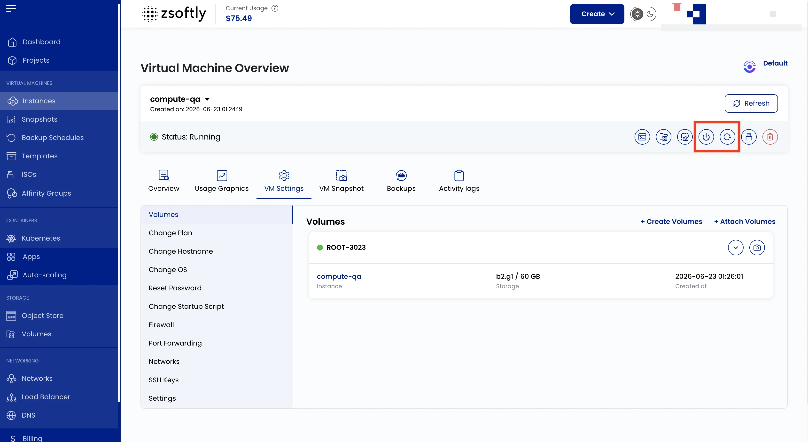

Use Power Management to control the running state of your VM instance.

## Manual Power Actions

Available from the Instance Overview:

- **Power Off**: Gracefully shuts down the VM.
- **Reboot**: Restarts the VM.
- **Power On**: Starts a stopped VM.

## See also

- [Instance Overview](/public-cloud/compute/instance-overview)
- [Activity Logs](/public-cloud/compute/activity-logs)
- [Backups](/public-cloud/backups-snapshots/backups)
